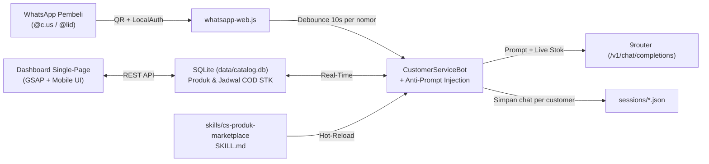

# Classic Project — WhatsApp AI Seller & Catalog Dashboard


Asisten penjual WhatsApp otomatis berbasis **AI + Knowledge Markdown + SQLite Catalog** dengan gaya bahasa penjual asli Indonesia, dilengkapi **Dashboard Single-Page (GSAP Motion, Responsif Mobile)** untuk manajemen katalog produk, stok real-time, gambar produk, serta pencatatan jadwal COD.

---

## Arsitektur Sistem



---

## Fitur Utama

### 1. WhatsApp Bot (`whatsapp-web.js` + `LocalAuth`)
- **Login QR Sekali Saja**: Scan QR barcode di terminal pada pemakaian pertama; session tersimpan di `.wwebjs_auth/` untuk dipakai ulang saat restart.
- **Debounce 10 Detik Per Nomor**: Beberapa *bubble* chat cepat dari satu nomor WA digabung menjadi satu konteks sebelum dijawab.
- **Resolusi Nomor Asli `@lid`**: Otomatis mengambil nomor telepon asli (`08...`) dan nama kontak WA melalui `getContact()` agar mudah dicari saat HP dibawa COD.
- **Shareloc Pin Peta WhatsApp Asli**: Mendukung pengiriman pin `Location` bawaan WhatsApp untuk titik COD tanpa mengirim link mentah.
- **Memori Percakapan Persisten**: Riwayat obrolan disimpan per customer di `sessions/*.json` agar tetap nyambung meski bot di-restart.

### 2. Persona Penjual & Knowledge Hot-Reload
- **Gaya Penjual Asli Indonesia**: Membalas santai, singkat, dan terstruktur dengan baris baru (Enter) serta list yang nyaman dibaca di HP—tanpa tanda bintang Markdown (`*...*`) dan tanpa terdengar seperti bot.
- **Hot-Reload**: Setiap perubahan di [SKILL.md](skills/cs-produk-marketplace/SKILL.md) dan katalog SQLite langsung terbaca otomatis tanpa restart.
- **Kerahasiaan Jumlah Stok**: Tidak membocorkan angka sisa stok kecuali pembeli meminta jumlah melebihi stok yang tersedia.

### 3. Dashboard Single-Page (GSAP Motion + Mobile Responsive)
- **Animasi Halus (GSAP)**: Transisi tab, kartu statistik, modal form, dan notifikasi toast yang responsif di desktop maupun HP.
- **Katalog Produk SQLite (`node:sqlite`)**: Tambah, edit, hapus, upload/URL gambar produk, pencarian, filter status (`Tersedia` / `Habis`), dan tombol cepat stok `-1` / `+1`.
- **Form & Daftar Jadwal COD (STK)**: Mencatat jadwal COD di titik `STK Sedulur Tunggal Kopi (STK KUSBANG)`—baik input manual dari dashboard maupun otomatis dari chat WhatsApp—lengkap dengan tombol **Chat WA** langsung.
- **Database Game, Spek PC & Login WA**: Kelola 2.895+ game & 28 konsol dengan *smart pagination*, edit KB rekomendasi spek PC, serta lihat QR code & kontrol login/logout WhatsApp langsung dari web.
- **Pencarian Spek Laptop Otomatis + Cache SQLite**: Mencari spek CPU/GPU laptop pembeli di internet sekali lalu menyimpannya ke tabel `laptop_specs_kb` agar pertanyaan berikutnya untuk laptop yang sama langsung dijawab tanpa search ulang.
- **Akses Jaringan Lokal (LAN/HP)**: Server listen di `0.0.0.0:3001` sehingga bisa dibuka dari HP dalam satu jaringan WiFi.

### 4. Keamanan & Logging
- **Anti-Prompt Injection 3 Lapis**: Sanitasi tag kontrol palsu, deteksi pola jailbreak/exfiltration sebelum memanggil LLM, delimiter `<pesan_pembeli>`, dan guard kebocoran output.
- **Daily Logs**: Log aktivitas & error tersimpan rapi di `logs/app-YYYY-MM-DD.log` dan `logs/error-YYYY-MM-DD.log` (juga bisa dilihat via `GET /logs`).

---

## Struktur Proyek

```text
├── public/
│   └── dashboard.html          # Panel Web (GSAP Motion + Mobile Responsive + QR Login WA)
├── skills/
│   └── cs-produk-marketplace/
│       └── SKILL.md            # Persona penjual & aturan komunikasi
├── src/
│   ├── bot.js                  # Orkestrator chat, debounce 10s, COD, foto & shareloc
│   ├── catalogDb.js            # SQLite database (products, cod_orders, games_kb, laptop_specs_kb)
│   ├── config.js               # Konfigurasi & deteksi browser Chrome/Edge
│   ├── index.js                # Entrypoint WhatsApp Client + Express server
│   ├── knowledge.js            # Hot-reload loader + parser tag internal
│   ├── llm.js                  # Client 9router (/v1/chat/completions)
│   ├── logger.js               # File & console logger harian
│   ├── security.js             # Anti-prompt injection & readability formatter
│   ├── server.js               # REST API katalog, game, spek PC, COD, WA login & test-chat
│   ├── sessionStore.js         # Memori percakapan persisten per customer
│   └── webSearch.js            # Pencarian spek laptop (Bing + Wikipedia)
├── test/
│   └── bot.test.js             # Unit & integration tests (node:test)
├── .env.example                # Contoh konfigurasi environment
├── LICENSE                     # MIT License
├── setup.bat                   # Setup otomatis Windows (double-click / CMD)
├── setup.ps1                   # Setup otomatis Windows (PowerShell)
├── setup.sh                    # Setup otomatis Linux / macOS
└── package.json
```

---

## Cara Menjalankan

### Setup Otomatis di Laptop Baru (1 Script)
- **Windows (Double-click / CMD)**: Jalankan [setup.bat](setup.bat)
- **Windows (PowerShell)**:
  ```powershell
  Set-ExecutionPolicy -Scope Process Bypass; .\setup.ps1
  ```
- **Linux / macOS**:
  ```bash
  chmod +x setup.sh && ./setup.sh
  ```
Ketiga script ([setup.bat](setup.bat), [setup.ps1](setup.ps1), [setup.sh](setup.sh)) otomatis mengecek/menginstall **Node.js 24+**, **Chrome/Chromium**, menjalankan `npm install`, menyiapkan `.env`, membuat folder `data`/`logs`/`sessions`, dan menjalankan `npm test`.

### Setup Manual
1. **Install dependencies** (Node.js 24+):
   ```bash
   npm install
   ```
2. **Salin dan sesuaikan konfigurasi**:
   ```bash
   cp .env.example .env
   ```
   Pastikan `ROUTER_BASE_URL`, `ROUTER_API_KEY`, dan `ROUTER_MODEL` sudah sesuai dengan instance **9router** Anda.
3. **Jalankan bot & dashboard**:
   ```bash
   npm start
   ```
4. **Scan QR WhatsApp** yang muncul di terminal lewat *Perangkat Tertaut* di HP Anda (cukup sekali saat awal).
5. **Buka Dashboard**:
   - Di laptop: `http://localhost:3001/`
   - Di HP (satu jaringan WiFi): gunakan URL `Akses LAN/HP` yang tampil di terminal saat startup.

---

## API Endpoints (Request & Response)

Base URL lokal: `http://localhost:3001` (atau `http://<IP-LAN-Laptop>:3001` dari HP dalam 1 jaringan WiFi).

### 1. Dashboard & Health

#### `GET /` atau `GET /dashboard`
Menampilkan halaman dashboard single-page (`public/dashboard.html`).

#### `GET /health`
Mengecek status koneksi WhatsApp dan 9router.

**Response (`200 OK`):**
```json
{
  "status": "ok",
  "whatsapp": "ready",
  "model": "CS",
  "router": {
    "ok": true,
    "status": 200
  }
}
```

---

### 2. Katalog Produk (SQLite)

#### `GET /api/products`
Mengambil seluruh daftar produk dari `data/catalog.db`.

**Response (`200 OK`):**
```json
{
  "ok": true,
  "products": [
    {
      "id": 2,
      "name": "Plug and Play by Classic Project",
      "category": "Konsol",
      "variant": "250 GB",
      "price": 300000,
      "stock": 5,
      "is_active": 1,
      "image_url": "/uploads/prod-17323456.jpg",
      "notes": "Paket termurah yang tersedia",
      "updated_at": "2026-11-23T07:00:00.000Z"
    }
  ]
}
```

#### `POST /api/products`
Menambahkan produk baru ke katalog SQLite.

**Request:**
```json
{
  "name": "Kabel HDMI 2 Meter",
  "category": "Aksesori",
  "variant": "2M",
  "price": 25000,
  "stock": 8,
  "image_url": "/uploads/hdmi.jpg",
  "notes": "Kabel tambahan ke TV",
  "is_active": 1
}
```

**Response (`201 Created`):**
```json
{
  "ok": true,
  "product": {
    "id": 8,
    "name": "Kabel HDMI 2 Meter",
    "category": "Aksesori",
    "variant": "2M",
    "price": 25000,
    "stock": 8,
    "is_active": 1,
    "image_url": "/uploads/hdmi.jpg",
    "notes": "Kabel tambahan ke TV",
    "updated_at": "2026-11-23T07:05:00.000Z"
  }
}
```

#### `PUT /api/products/:id`
Memperbarui data produk berdasarkan `id`.

**Request:**
```json
{
  "price": 28000,
  "stock": 10,
  "notes": "Kabel HDMI versi terbaru"
}
```

**Response (`200 OK`):**
```json
{
  "ok": true,
  "product": {
    "id": 8,
    "name": "Kabel HDMI 2 Meter",
    "category": "Aksesori",
    "variant": "2M",
    "price": 28000,
    "stock": 10,
    "is_active": 1,
    "image_url": "/uploads/hdmi.jpg",
    "notes": "Kabel HDMI versi terbaru",
    "updated_at": "2026-11-23T07:06:00.000Z"
  }
}
```

#### `PATCH /api/products/:id/stock`
Mengubah stok secara cepat menggunakan selisih (`delta`) atau nilai langsung (`stock`).

**Request (contoh kurangi 1 stok):**
```json
{
  "delta": -1
}
```

**Response (`200 OK`):**
```json
{
  "ok": true,
  "product": {
    "id": 8,
    "name": "Kabel HDMI 2 Meter",
    "category": "Aksesori",
    "variant": "2M",
    "price": 28000,
    "stock": 9,
    "is_active": 1,
    "image_url": "/uploads/hdmi.jpg",
    "notes": "Kabel HDMI versi terbaru",
    "updated_at": "2026-11-23T07:07:00.000Z"
  }
}
```

#### `DELETE /api/products/:id`
Menghapus produk dari katalog.

**Response (`200 OK`):**
```json
{
  "ok": true
}
```

#### `POST /api/upload`
Mengunggah gambar produk (PNG, JPG, WEBP, GIF) dalam format base64 Data URL.

**Request:**
```json
{
  "dataUrl": "data:image/png;base64,iVBORw0KGgoAAAANSUhEUg..."
}
```

**Response (`201 Created`):**
```json
{
  "ok": true,
  "url": "/uploads/prod-1795334800000-a1b2c.png"
}
```

---

### 3. Jadwal COD Tempat STK (SQLite)

#### `GET /api/cod`
Mengambil daftar semua client yang menjadwalkan COD di `STK Sedulur Tunggal Kopi (STK KUSBANG)`.

**Response (`200 OK`):**
```json
{
  "ok": true,
  "orders": [
    {
      "id": 1,
      "customer_name": "Budi",
      "customer_phone": "081234567890",
      "product_name": "Plug and Play by Classic Project (500 GB)",
      "qty": 1,
      "cod_date": "2026-11-23",
      "cod_time": "19:00",
      "location": "STK Sedulur Tunggal Kopi (STK KUSBANG)",
      "status": "menunggu",
      "notes": "Tambah stik PS3 1 pcs",
      "created_at": "2026-11-23T07:10:00.000Z",
      "updated_at": "2026-11-23T07:10:00.000Z"
    }
  ]
}
```

#### `POST /api/cod`
Mencatat jadwal COD baru (lokasi otomatis diset ke `STK Sedulur Tunggal Kopi (STK KUSBANG)`).

**Request:**
```json
{
  "customer_name": "Budi",
  "customer_phone": "081234567890",
  "product_name": "Plug and Play by Classic Project (500 GB)",
  "qty": 1,
  "cod_date": "2026-11-23",
  "cod_time": "19:00",
  "notes": "Tambah stik PS3 1 pcs"
}
```

**Response (`201 Created`):**
```json
{
  "ok": true,
  "order": {
    "id": 1,
    "customer_name": "Budi",
    "customer_phone": "081234567890",
    "product_name": "Plug and Play by Classic Project (500 GB)",
    "qty": 1,
    "cod_date": "2026-11-23",
    "cod_time": "19:00",
    "location": "STK Sedulur Tunggal Kopi (STK KUSBANG)",
    "status": "menunggu",
    "notes": "Tambah stik PS3 1 pcs",
    "created_at": "2026-11-23T07:10:00.000Z",
    "updated_at": "2026-11-23T07:10:00.000Z"
  }
}
```

#### `PATCH /api/cod/:id/status`
Mengubah status jadwal COD (`menunggu`, `selesai`, atau `batal`).

**Request:**
```json
{
  "status": "selesai"
}
```

**Response (`200 OK`):**
```json
{
  "ok": true,
  "order": {
    "id": 1,
    "customer_name": "Budi",
    "customer_phone": "081234567890",
    "product_name": "Plug and Play by Classic Project (500 GB)",
    "qty": 1,
    "cod_date": "2026-11-23",
    "cod_time": "19:00",
    "location": "STK Sedulur Tunggal Kopi (STK KUSBANG)",
    "status": "selesai",
    "notes": "Tambah stik PS3 1 pcs",
    "created_at": "2026-11-23T07:10:00.000Z",
    "updated_at": "2026-11-23T07:15:00.000Z"
  }
}
```

#### `DELETE /api/cod/:id`
Menghapus jadwal COD berdasarkan `id`.

**Response (`200 OK`):**
```json
{
  "ok": true
}
```

---

### 4. Simulasi Chat & Log

#### `POST /test-chat`
Menguji respons AI dengan knowledge & stok SQLite terbaru tanpa mengirim WhatsApp sungguhan.

**Request:**
```json
{
  "chatId": "uji-1",
  "message": "Paket 500 GB masih ada kak?"
}
```

**Response (`200 OK`):**
```json
{
  "ok": true,
  "chatId": "uji-1",
  "reply": "Masih ready ya kak, paket 500 GB harganya Rp 400.000.\n\nMau sekalian tambah stik atau rencana ambilnya gimana kak?",
  "escalation": null,
  "shareloks": [],
  "codBookings": []
}
```

#### `POST /test-chat/reset`
Menghapus riwayat percakapan simulasi untuk `chatId` tertentu.

**Request:**
```json
{
  "chatId": "uji-1"
}
```

**Response (`200 OK`):**
```json
{
  "ok": true,
  "cleared": "uji-1"
}
```

#### `GET /logs?type=error&lines=100`
Membaca baris log terbaru hari ini (`type=app` untuk semua aktivitas atau `type=error` khusus peringatan & error).

**Response (`200 OK`):**
```json
{
  "ok": true,
  "type": "error",
  "dir": "C:\\project\\CS\\logs",
  "lines": [
    "[2026-11-23 14:04:30.038] [WARN] [LLM] Model \"main\" gagal..."
  ]
}
```

---

### 5. Database Game, Konsol, Spek PC & Cache Laptop

- `GET /api/systems` — Daftar konsol/platform beserta jumlah game & minimum spek.
- `GET /api/games?q=god&system=ps2&page=1&limit=25` — Pencarian game dengan *smart pagination* (`games`, `total`, `page`, `limit`, `totalPages`).
- `POST /api/games`, `PUT /api/games/:id`, `DELETE /api/games/:id` — Tambah, edit, dan hapus game.
- `GET /api/kb/pc` & `PUT /api/kb/pc` — Baca dan update JSON rekomendasi spek PC & setting Batocera.
- `GET /api/laptops` & `DELETE /api/laptops/:id` — Lihat dan hapus cache spek laptop hasil pencarian internet.

---

### 6. Kontrol Login WhatsApp (Web)

- `GET /api/wa/status` — Status koneksi WA, string `qr` (saat `waiting_qr`), serta info akun (`pushname`, `wid`).
- `POST /api/wa/restart` — Restart koneksi `whatsapp-web.js`.
- `POST /api/wa/logout` — Logout dari akun WA saat ini dan siapkan QR code baru.

---

## Pengujian

```bash
npm test
```

---

## Lisensi

Proyek ini dirilis di bawah lisensi [MIT](LICENSE).
